# Deliverable 2: Personalized Markov Models and Clustering

COSC 449 Honours Thesis · Justin Doig

## Summary

- **Task.** I predict the code of each reviewer utterance (one of 14 behaviours, such as Approving or Directing) from two things: who wrote it, and the code they used just before it in the same pull request. Section 1 defines these terms, and Section 3 defines the tasks, models and metrics.
- **Models.** I built a first-order Markov model for each commenter: a table giving the chance of each code, depending on the previous code. I compare it with three simpler models, two of which are versions of the Deliverable 1 baselines.
- **Personal models use only personal data.** Most cells of a personal table are empty, so each personal Markov model is run two ways:
  - **Normalized smoothing** adds "pretend" observations shared out in proportion to *that commenter's own* code frequencies, never evenly. The population plays no part. This is the main option.
  - **No smoothing** uses raw proportions.
  - In both, a probability that would be 0 is replaced by a fixed, tiny ε (10⁻¹⁰). This lets the cross-entropy be computed without giving the code any real probability.
- **Predicting the code (14 classes).** The personal Markov model has the **highest accuracy**: 40.9%, against 38.0% for personal code frequencies, 32.0% for the overall Markov model and 22.9% for overall code frequencies.
- **Cross-entropy.** On this measure the **overall Markov model is best** (2.76 bits against 3.12). In 2.3% of test utterances a commenter used a code they had never used in training. The personal models give those codes only ε, and each such utterance costs 33 bits.
- **The yes/no tasks from Deliverable 1.** The personal Markov model **raises macro-F1 for Approving, Empty and Updating** over the Deliverable 1 personal majority. For the other 11 codes it never gives a chance above 50%, so it always predicts "no".
- **Smoothing versus none.** Without smoothing, top guesses are about as good (accuracy 0.407) and yes/no macro-F1 is higher on 12 codes. But 13.4% of test utterances get only ε, so cross-entropy is 6.21 bits, worse than guessing uniformly.
- **Clusters.** Clustering the 56 commenters with enough data gives **two groups**: approval-oriented reviewers (30) and Empty/Directing reviewers (26). The grouping is almost identical to clustering on code frequencies alone (adjusted Rand index 0.93). So it reflects which codes people use, not the order they use them in.

## 1. Data

### 1.1 Terms

The data are review comments on GitHub pull requests from 22 software teams, written between 30 September 2023 and 16 April 2024. The comment text is not included. Instead, each comment has been split into utterances, and each utterance has been coded by hand.

| Term | Meaning in this report |
|---|---|
| **Team** | One of the 22 teams. Each team numbers its pull requests separately, and every commenter belongs to exactly one team. |
| **Pull request (PR)** | A proposed code change that teammates review and comment on. A PR is identified by its team and its `pr_id`. |
| **Commenter** | The GitHub user who wrote a comment. This is usually a reviewer, but 11% of utterances were written by the PR's own author, for example when replying to a review. |
| **Comment** | One review comment posted on a PR, identified by `comment_id`. |
| **Utterance** | One part of a comment that has a single code. A comment holds one or more utterances. **One row of the data is one utterance.** |
| **Code** | The behaviour a human coder assigned to an utterance: one of the 14 in Table 3. Each utterance has exactly one code. Deliverable 1 called these "behaviours"; this report says "code" throughout. |
| **Sequence** | One commenter's utterances inside one PR, in time order (Section 2). |
| **Transition** | Two consecutive codes in a sequence, written *previous → next*. |

For example, comment 1356009388 (team 1, PR 15) is three rows of the data: Directing, Explaining, Directing. It is one comment with three utterances. The two Directing utterances are counted separately, so a repeated code inside a comment is never merged.

### 1.2 Overview of teams, commenters and comments

*Table 1. Size of the data.*

| | Count | Notes |
|---|---|---|
| Teams | 22 | 4 to 6 commenters each (median 5) |
| Commenters | 106 | |
| Pull requests | 2,796 | |
| Comments | 11,138 | 71% contain a single utterance; the largest contains 25 |
| Utterances | 16,272 | 1.46 per comment on average |

*Table 2. How much data each commenter has.*

| Per commenter | Min | 25th percentile | Median | 75th percentile | Max |
|---|---|---|---|---|---|
| Utterances | 3 | 50 | 73 | 172 | 2,125 |
| Comments | 2 | 32 | 53 | 99 | 1,455 |
| PRs commented on | 2 | 29 | 41 | 67 | 222 |
| Different codes used (of 14) | 1 | 6 | 8 | 11 | 14 |
| Within-PR transitions (Section 2) | 0 | 12 | 33 | 96 | 2,008 |

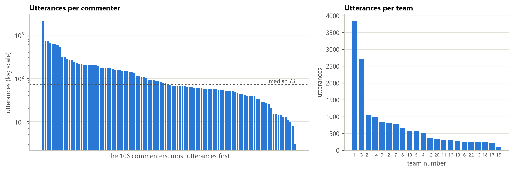

*Figure 1. Left: utterances per commenter, largest first, on a log scale. Right: utterances per team.*

**What this shows.** The amount of data is very uneven, both across commenters and across teams.

- **Commenters.** The median commenter wrote 73 utterances, but the busiest wrote 2,125 and the quietest wrote 3. The 10 busiest commenters wrote 44% of all utterances, while 15 commenters wrote fewer than 30 each. The median commenter used only 8 of the 14 codes.
- **Teams.** Team 1 contributed 24% of all utterances and team 3 contributed 17%. Team 15 contributed 95 utterances.

This matters for two reasons. First, a personal model for a commenter with little data has almost nothing to learn from, so the personal models borrow strength from the whole population (Section 3.4). Second, results pooled over all utterances are dominated by a handful of commenters and two teams.

A fuller description of the data, generated by `src/data_description.py`, is on GitHub: [data_description.txt](https://github.com/JDoig4/COSC_449-Honours-Thesis/blob/main/data_description.txt).

### 1.3 Codes

<!-- TODO (Justin): add a one-line definition of each code from the codebook, e.g. as a third column. -->

*Table 3. How many utterances have each code.*

| Code | Utterances | % of utterances |
|---|---|---|
| Approving | 3,730 | 22.9 |
| Empty | 3,685 | 22.6 |
| Updating | 2,684 | 16.5 |
| Directing | 2,075 | 12.8 |
| Criticizing | 1,287 | 7.9 |
| Complimenting | 633 | 3.9 |
| Explaining | 490 | 3.0 |
| Asking | 473 | 2.9 |
| Thanking | 335 | 2.1 |
| Agreeing | 286 | 1.8 |
| Suggesting | 253 | 1.6 |
| Encouraging | 199 | 1.2 |
| Disagreeing | 103 | 0.6 |
| Apologizing | 39 | 0.2 |
| **Total** | **16,272** | **100.0** |

**What this shows.** Four codes (Approving, Empty, Updating and Directing) make up 75% of utterances. Each of the other ten makes up less than 8%. No code reaches 50%, even the most common one. So for every code, most utterances do *not* have that code. This is why the majority baselines in Deliverable 1 always answered "no" (Section 3.4).

## 2. Sequences

Following Bowen's feedback on the draft, sequences are split by PR. A **sequence** is one commenter's utterances inside one PR (keyed by team, `pr_id` and commenter), sorted by `created_at`. Utterances from the same comment share a timestamp, so they keep their file order. Every sequence begins in a **START** state, so a PR where someone wrote a single utterance still records which code they opened with.

*Table 4. Sequences and transitions.*

| | Count |
|---|---|
| Utterances | 16,272 |
| Sequences (one commenter in one PR) | 5,781 |
| Sequences with a single utterance | 3,213 (56%) |
| Within-PR transitions (code → code) | 10,491 |
| Opening transitions (START → code) | 5,781 |

**What this shows.** In 56% of sequences, the commenter wrote once in that PR and nothing more. Those sequences only tell the model how commenters open a PR (START → code). Which code follows which is learned from the 10,491 within-PR transitions, which all come from the 44% of sequences with two or more utterances.

My draft counted 9,993 transitions for this option. That count started a new sequence whenever a commenter returned to a PR after commenting elsewhere, and grouping by PR joins those visits.

Splitting by PR also mostly settles the long-gaps question from the draft. Within a PR, the median gap between consecutive utterances is 0 hours (49% of pairs are in the same comment), 90% of gaps are under 12 minutes, and 99% are under 90 hours. The few longer gaps (the longest is 132 days) are kept as they are.

## 3. Prediction tasks, models and metrics

### 3.1 Notation

- $\mathcal{C}$ is the set of 14 codes.
- For an utterance $t$:
  - $c_t$ is its commenter.
  - $y_t \in \mathcal{C}$ is its code.
  - $s_t$ is its **previous code**: the code of the same commenter's previous utterance in the same PR, or START if $t$ is the first.
- In the training set:
  - $N$ is the number of utterances, and $n(k)$ is the number with code $k$.
  - $n_c$ is the number of utterances by commenter $c$, and $n_c(k)$ is how many of those have code $k$.
  - $n(s \to k)$ is the number of transitions from $s$ to $k$, and $n(s) = \sum_k n(s \to k)$.
  - $n_c(s \to k)$ and $n_c(s)$ are the same counts for commenter $c$ alone.

### 3.2 Two prediction tasks

Each model is scored on two tasks. In both, the model sees only the commenter and the previous code, because the data has no text.

**Task A: predict the code (14 classes).** Given $c_t$ and $s_t$, predict $y_t$. This is the multiclass task discussed after Deliverable 1, and it is the main task in this report. Every model gives a probability $P(k \mid \cdot)$ to each of the 14 codes. Its **prediction** is the most probable code, $\hat y_t = \arg\max_k P(k \mid \cdot)$. If two codes tie for the highest probability, which is common without smoothing, the prediction is the one that is more common in the training set. The classes are the 14 codes.

**Task B: yes/no for each code (the Deliverable 1 tasks).** For one code $k$, predict whether $y_t = k$. There are two classes:

- **yes**: the utterance has code $k$.
- **no**: it has any of the other 13 codes.

This gives 14 separate tasks, one per code. A model says "yes" when it gives code $k$ a probability above 0.5, and "no" otherwise.

### 3.3 Training and test sets

- **How the split was made.** The data is split into two equal halves, a **training set** (used to fit the models) and a **test set** (used only for scoring). The split uses scikit-learn's `StratifiedGroupKFold` with two folds and random seed 41.
  - It is **grouped by comment**: all utterances of a comment go to the same half, so a model is never tested on a comment it has partly seen.
  - It is **stratified by code**: each half gets the same mix of codes, and the code shares in the two halves differ by less than 0.02 percentage points.
- **Result.**
  - The training set has 8,136 utterances (5,565 comments) and the test set has 8,136 utterances (5,573 comments).
  - 105 of the 106 commenters appear in both halves, and one appears only in training. No test utterance comes from a commenter the models have not seen.
- **Why 50/50.** The test set has to contain enough examples of the rare codes to measure how well they are found. With half the data, the test set has 20 Apologizing and 52 Disagreeing utterances. An 80/20 split would leave about 8 and 21. The cost is less training data per commenter, which the smoothing in Section 3.4 handles.
- **The same split as Deliverable 1.** All models, old and new, are scored on exactly the same test utterances, so their results can be compared directly.

Each test utterance is predicted from its actual previous code, which may belong to a training or a test utterance. This is the information a model would have when predicting in real time.

### 3.4 Models

There are four models. Each one adds one idea to the one before it. **The two personal models use only the commenter's own data.** The population is used only for a commenter with no training data at all, which never happens in the test set (Section 3.3).

**Overall frequency.** Everyone gets the same probabilities: how common each code is in the training set. Every code appears in the training set, so no probability is 0.

$$P(k) = \frac{n(k)}{N}$$

**Personal frequency.** How common each code is for this commenter. It is never smoothed. A code the commenter never used in training gets the fixed stand-in $\varepsilon$ (below) instead of 0.

$$P_c(k) = \frac{n_c(k)}{n_c}$$

**Overall Markov.** The chance of the next code given the previous code, pooled over everyone. With smoothing, it is pulled toward the overall code frequencies:

$$P_{\text{pop}}(k \mid s) = \frac{n(s \to k) + \beta \, P(k)}{n(s) + \beta}$$

**Personal Markov.** The chance of the next code given the previous code, for this commenter. With smoothing, it is pulled toward **the commenter's own code frequencies**, not the population's:

$$P_c(k \mid s) = \frac{n_c(s \to k) + \alpha \, P_c(k)}{n_c(s) + \alpha}$$

**Smoothing: two options.** The personal tables are sparse. The median commenter has 33 within-PR transitions spread over 15 × 14 cells (Table 2), so most cells are 0. The two Markov models are therefore run in two ways; the frequency models are the same in both.

- **Normalized smoothing** ($\beta, \alpha > 0$). The strength acts as a number of "pretend" observations. They are shared out **in proportion to the prior, not evenly**. For the personal Markov model, the prior is the commenter's own code frequencies $P_c(k)$.
  - A row with plenty of data ($n_c(s)$ much larger than $\alpha$) is mostly that person's own transitions.
  - A row with no data is exactly the commenter's own code frequencies.
  - A code the commenter never used anywhere gets nothing from the prior, so it stays at 0 and is set to $\varepsilon$.
- **No smoothing** ($\beta = \alpha = 0$). Every row is its raw proportions, and every 0 is set to $\varepsilon$.
  - A row with no data at all has nothing to divide by, so it takes the commenter's own code frequencies.
  - This happens for 2.2% of test utterances, where a commenter reaches a previous code they never had in training.

**The stand-in for 0.** Any probability that would be exactly 0 is replaced by a fixed $\varepsilon = 10^{-10}$.

- **It is not smoothing.** It moves no probability toward the code, and every row still sums to 1 to within $14\varepsilon$.
- **It exists only because $\log_2 0$ is undefined**, which would make the cross-entropy (Section 3.5) impossible to compute.
- **It has a price.** A code that was given $\varepsilon$ and then occurs costs $\log_2(1/\varepsilon) \approx 33$ bits.

Table 5 shows the options on a real row. Commenter brittney30 has 102 training utterances. Their only utterance after Apologizing was an Empty, and they never used Asking, Apologizing, Disagreeing or Suggesting.

- **Add-one (Laplace) smoothing**, the usual textbook method, gives each of the 13 other codes the same chance, 0.067. This includes the four codes this commenter never used.
- **Normalized smoothing** shares the pretend observations by this commenter's own code mix. Approving, which makes up 59% of their utterances, gets 0.569. The four codes they never used stay at $\varepsilon$.
- **No smoothing** says Empty is certain and gives every other code $\varepsilon$.

*Table 5. Commenter brittney30's row after Apologizing (one transition, to Empty), under three kinds of smoothing (strength 30). "Own frequency" is the commenter's own code mix, which is the prior for normalized smoothing. Add-one is shown for comparison only and is not used.*

| Next code | Own frequency | Add-one | Normalized smoothing | No smoothing |
|---|---|---|---|---|
| Approving | 0.588 | 0.067 | 0.569 | ε |
| Empty | 0.088 | 0.133 | 0.118 | 1 |
| Encouraging | 0.078 | 0.067 | 0.076 | ε |
| Directing | 0.069 | 0.067 | 0.066 | ε |
| Criticizing | 0.059 | 0.067 | 0.057 | ε |
| Complimenting | 0.049 | 0.067 | 0.047 | ε |
| Updating | 0.029 | 0.067 | 0.028 | ε |
| Explaining | 0.020 | 0.067 | 0.019 | ε |
| Agreeing | 0.010 | 0.067 | 0.009 | ε |
| Thanking | 0.010 | 0.067 | 0.009 | ε |
| Asking | 0 | 0.067 | ε | ε |
| Apologizing | 0 | 0.067 | ε | ε |
| Disagreeing | 0 | 0.067 | ε | ε |
| Suggesting | 0 | 0.067 | ε | ε |

**What Table 5 shows.**

- **Add-one** gives the four codes this commenter never used the same chance as everything else.
- **Normalized smoothing** leaves those four codes at $\varepsilon$. Otherwise it follows the commenter's own habits, nudged toward the one Empty that was actually observed (0.088 → 0.118).
- **No smoothing** trusts that single observation completely.

**Choosing the strengths.** For normalized smoothing I chose each strength from {0.1, 0.3, 1, 3, 10, 30, 100}. The chosen strength had the lowest cross-entropy in 5-fold cross-validation **on the training set only**, with folds grouped by comment. The chosen values are $\beta = 30$ and $\alpha = 30$ (Appendix, Figure A1).

*Table 6. The four models and how each one predicts in the two tasks.*

| Model | Probability of code $k$ depends on | Task A prediction | Task B: says "yes" when |
|---|---|---|---|
| Overall frequency | nothing (same for everyone) | always Approving, the most common training code | overall majority (below) |
| Personal frequency | the commenter | the commenter's most common code | personal majority (below) |
| Overall Markov | the previous code | the most likely code after $s_t$ | $P_{\text{pop}}(k \mid s_t) > 0.5$ |
| Personal Markov | the previous code **and** the commenter | the commenter's most likely code after $s_t$ | $P_{c_t}(k \mid s_t) > 0.5$ |

**The Deliverable 1 baselines.** In Task B, the two frequency models are the Deliverable 1 baselines, applied exactly as before:

- **Overall majority:** say "yes" to code $k$ if $n(k)/N > 0.5$. No code reaches 0.5 (the largest is Approving at 0.229), so this baseline says **"no" to every code for every utterance**.
- **Personal majority:** say "yes" to code $k$ for commenter $c$ if $n_c(k)/n_c > 0.5$. That is, say yes only if the commenter used code $k$ in more than half of their training utterances.
  - An exact tie ($n_c(k)/n_c = 0.5$) falls back to the overall majority's answer, which is "no". This happens for two commenters on Approving and two on Updating.
  - A commenter with no training utterances also gets the overall majority's answer. This never happens in the test set (Section 3.3).

In Task A, the two frequency models are the 14-class versions of these baselines. Overall frequency always predicts the single most common code. Personal frequency predicts each commenter's own most common code.

### 3.5 Metrics

All metrics are computed on the $n$ = 8,136 test utterances.

**Cross-entropy (Task A).** The average surprise of the model at the code that actually occurred, in bits:

$$H = -\frac{1}{n} \sum_{t} \log_2 P(y_t \mid \cdot)$$

- Lower is better, and a model that is always certain and always right scores 0.
- Guessing uniformly over 14 codes scores $\log_2 14 = 3.81$ bits.
- It uses the whole probability distribution, not only the top guess. So it rewards a model for giving a rare code a sensible chance, even if that code is never the top guess.
- No model gives exactly 0 (Section 3.4). But a real code that was given only $\varepsilon$ adds $\log_2(1/\varepsilon) \approx 33.2$ bits to the sum. So I also report the share of test utterances whose real code got only $\varepsilon$. That share times 33.2 is how much of $H$ comes from them.

**Perplexity (Task A).** $2^H$: roughly, the number of equally likely codes the model is choosing between.

**Accuracy.** The share of test utterances predicted correctly:

$$\text{Accuracy} = \frac{1}{n}\sum_t \mathbb{1}[\hat y_t = y_t]$$

**Precision, recall and F1 (per class).** These are computed separately for each class. In Task A the classes are the 14 codes; in Task B they are "yes" and "no". For a class $k$:

- $TP_k$ (true positives) counts utterances that are in class $k$ and were predicted as $k$.
- $FP_k$ (false positives) counts utterances predicted as $k$ that are not in $k$.
- $FN_k$ (false negatives) counts utterances in $k$ that were predicted as something else.

$$\text{Precision}_k = \frac{TP_k}{TP_k + FP_k} \qquad \text{Recall}_k = \frac{TP_k}{TP_k + FN_k} \qquad F1_k = \frac{2 \cdot \text{Precision}_k \cdot \text{Recall}_k}{\text{Precision}_k + \text{Recall}_k}$$

- **Precision** is the share of predictions of $k$ that were right.
- **Recall** is the share of real $k$ utterances that were found.
- If a model never predicts $k$, its precision is undefined. It is shown as "–" in the tables and counted as 0 in F1.
- The "yes" and "no" scores do not add up to 1, because each is computed from different cells of the confusion matrix. For example, precision for "yes" uses the utterances predicted "yes", and precision for "no" uses those predicted "no".

**Macro-F1.** The plain average of the per-class F1 scores. Every class counts equally, however rare it is, so a model cannot score well by ignoring the rare classes:

$$\text{Macro-F1} = \frac{1}{K}\sum_{k=1}^{K} F1_k, \qquad K = 14 \text{ in Task A}, \; K = 2 \text{ in Task B}$$

**Why "always no" scores at most 0.5 in Task B.** Let $q$ be the share of test utterances in the "no" class. A model that always says "no" has:

- $F1_\text{yes} = 0$.
- Precision $q$ and recall 1 for "no", so $F1_\text{no} = 2q/(1+q)$.

Its macro-F1 is therefore $q/(1+q)$, which is below 0.5 and rises toward 0.5 as the code gets rarer. Its accuracy is $q$, which is why accuracy looks high for rare codes (0.998 for Apologizing) even though the model finds nothing. Macro-F1 is therefore the main measure for Task B.

**Confusion matrix.** This is not a metric but a table of counts: rows are the real class and columns are the predicted class. Every metric above can be computed from it. The figures use it to show where the errors go.

## 4. The population Markov model

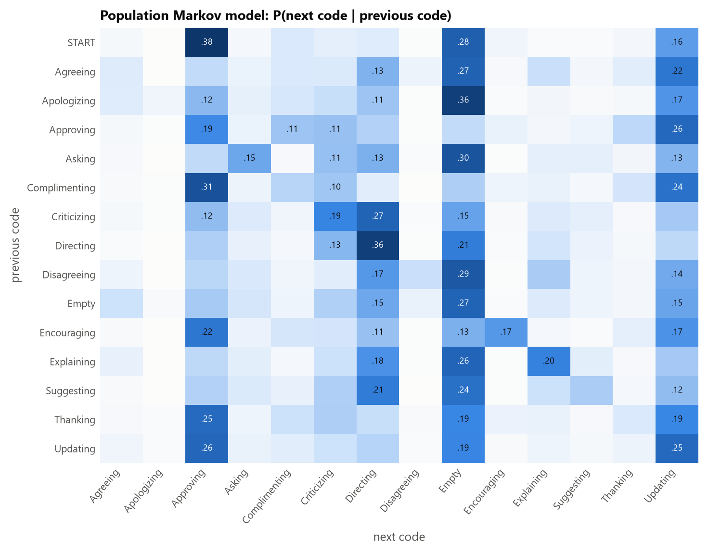

*Figure 2. The overall (population) Markov model, fit on all the data to describe it. Rows are the previous code, columns the next code, and each row adds to 1. Only probabilities of at least 0.10 are labelled.*

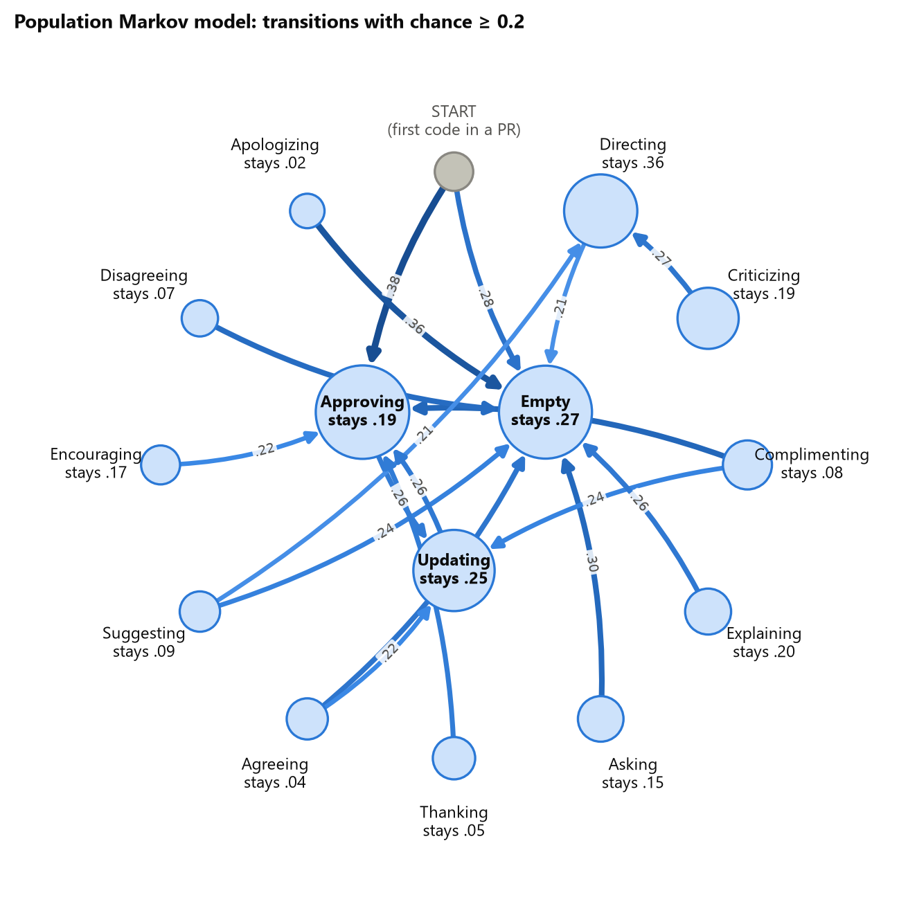

*Figure 3. The same model as a state diagram. It shows arrows with probability ≥ 0.2, and circle size shows how common each code is. The three most common codes sit in the middle.*

**What Figures 2 and 3 show.**

- **Opening a PR:** a commenter's first utterance in a PR is Approving 38% of the time, Empty 28% and Updating 16%.
- **Persistence:** codes tend to repeat. Directing repeats most (0.36), followed by Empty (0.27), Updating (0.25) and Explaining (0.20).
- **Criticizing → Directing (0.27):** criticism is usually followed by an instruction.
- **Positive codes lead to approval:** Complimenting → Approving 0.31, Thanking → Approving 0.25, Encouraging → Approving 0.22.
- **Approving and Updating alternate:** each follows the other with probability 0.26.
- Asking, Disagreeing and Apologizing are most often followed by Empty (0.30, 0.29 and 0.36).
- **With smoothing, no probability reaches 0.5.** The largest is START → Approving at 0.38, and the largest between two codes is Directing → Directing at 0.36. So the smoothed overall Markov model never gives any code more than a 50% chance, and in Task B it always says "no" (Section 6). Without smoothing, one row crosses 0.5: in the training set, 52% of the 21 transitions after Apologizing go to Empty.

Section 7 shows how individual commenters differ from this model (Figures 9 and 10).

## 5. Results: predicting the code (Task A, 14 classes)

*Table 7. Task A on the test set. ↓ means lower is better. "Given ε" is the share of test utterances whose real code the model gave only ε; each of these adds about 33 bits to the cross-entropy sum.*

| Model | Smoothing | Cross-entropy (bits) ↓ | Perplexity ↓ | Given ε | Accuracy | Macro-F1 |
|---|---|---|---|---|---|---|
| Overall frequency | never smoothed | 3.01 | 8.05 | 0% | 0.229 | 0.027 |
| Personal frequency | never smoothed | 3.21 | 9.25 | 2.3% | 0.380 | 0.123 |
| Overall Markov | normalized | **2.76** | **6.77** | 0% | 0.320 | 0.101 |
| Overall Markov | none | 2.83 | 7.10 | 0.3% | 0.320 | 0.107 |
| Personal Markov | normalized | 3.12 | 8.67 | 2.3% | **0.409** | 0.148 |
| Personal Markov | none | 6.21 | 74.1 | 13.4% | 0.407 | **0.176** |

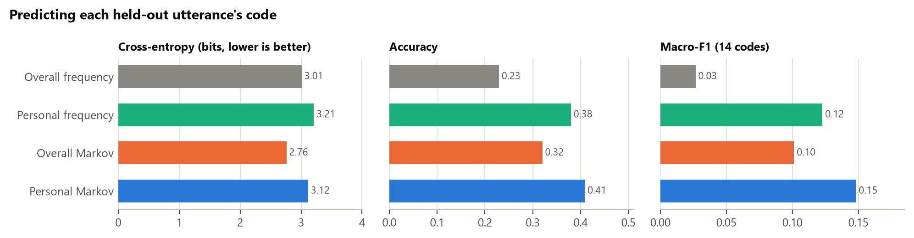

*Figure 4. The normalized-smoothing rows of Table 7 as bars (the two frequency models are never smoothed).*

**What Table 7 and Figure 4 show.**

- **Top guesses: the personal Markov model is best.** With normalized smoothing it predicts 40.9% of codes correctly, against 38.0% for personal frequency, 32.0% for overall Markov and 22.9% for overall frequency. Knowing the commenter helps more than knowing the previous code, and the two together help most.
- **Probabilities: the overall Markov model is best.** Its cross-entropy is 2.76 bits, against 3.12 for personal Markov and 3.21 for personal frequency. Both personal models score worse than overall frequency (3.01).
- **Why the personal models lose on cross-entropy.**
  - In 187 test utterances (2.3%), the commenter used a code they had never used in training. The personal models give that code only ε, so each of these utterances costs 33 bits.
  - Together they add 0.76 bits to the personal Markov model's 3.12. On the other 97.7% of test utterances, it averages 2.41 bits.
  - This is the direct cost of keeping the personal models personal: they cannot expect a commenter to do something that commenter has never done.
- **The size of that cost is set by ε, not by the data.** With ε = 10⁻⁶ the personal Markov model would score 2.81 bits, and with ε = 10⁻¹⁶ it would score 3.58. The overall Markov model stays ahead in both cases.
- **No smoothing.** Its top guesses are about as good: accuracy 0.407, and the best macro-F1, 0.176. But 13.4% of test utterances get only ε, so its cross-entropy is 6.21 bits, worse than guessing uniformly (3.81).
  - Most of these misses (83%) are codes the commenter *did* use, just never after that previous code in training.
  - Normalized smoothing fills those cells from the commenter's own code frequencies, which is why its ε share is only 2.3%.
- **Overall frequency.** Its accuracy (0.229) is simply the share of Approving in the test set, because it predicts Approving every time.
- **Macro-F1 is low for every model** because it averages over all 14 codes, most of which are rarely or never predicted (Table 8).

*Table 8. Task A, for every code. The Markov F1 columns use normalized smoothing unless marked. "Predicted / precision / recall" is for the personal Markov model with normalized smoothing.*

| Code | Test utterances | F1: overall freq. | F1: personal freq. | F1: overall Markov | F1: personal Markov | F1: personal Markov, no smoothing | Personal Markov: predicted / precision / recall |
|---|---|---|---|---|---|---|---|
| Approving | 1,865 | 0.37 | 0.47 | 0.47 | 0.51 | **0.52** | 2,635 / 0.43 / 0.61 |
| Empty | 1,842 | 0.00 | 0.48 | 0.26 | **0.52** | 0.51 | 2,810 / 0.43 / 0.66 |
| Updating | 1,342 | 0.00 | 0.31 | 0.28 | **0.34** | 0.33 | 1,167 / 0.37 / 0.32 |
| Directing | 1,037 | 0.00 | 0.32 | 0.40 | 0.40 | **0.41** | 1,329 / 0.36 / 0.46 |
| Criticizing | 644 | 0.00 | 0.14 | 0.00 | 0.09 | **0.15** | 120 / 0.30 / 0.06 |
| Complimenting | 317 | 0.00 | 0.00 | 0.00 | 0.11 | **0.15** | 41 / 0.49 / 0.06 |
| Explaining | 245 | 0.00 | 0.00 | 0.00 | 0.00 | **0.12** | 2 / 0.00 / 0.00 |
| Asking | 236 | 0.00 | 0.00 | 0.00 | 0.00 | **0.05** | 0 / – / 0.00 |
| Thanking | 167 | 0.00 | 0.00 | 0.00 | **0.08** | **0.08** | 31 / 0.26 / 0.05 |
| Agreeing | 143 | 0.00 | 0.00 | 0.00 | 0.00 | **0.04** | 0 / – / 0.00 |
| Suggesting | 127 | 0.00 | 0.00 | 0.00 | 0.02 | **0.07** | 1 / 1.00 / 0.01 |
| Encouraging | 99 | 0.00 | 0.00 | 0.00 | 0.00 | **0.04** | 0 / – / 0.00 |
| Disagreeing | 52 | 0.00 | 0.00 | 0.00 | 0.00 | 0.00 | 0 / – / 0.00 |
| Apologizing | 20 | 0.00 | 0.00 | 0.00 | 0.00 | 0.00 | 0 / – / 0.00 |

**What Table 8 shows.**

- **The four common codes carry most of the score.** For the personal Markov model (normalized), they have F1 between 0.34 and 0.52, and every other code is at 0.11 or below.
- **Rare codes are predicted more often without smoothing.** With normalized smoothing, the personal Markov model predicts 9 of the 14 codes at least once; without smoothing it predicts 12.
  - Without smoothing, rare codes get higher F1, for example Explaining 0.12 against 0.00 and Criticizing 0.15 against 0.09.
  - A raw row can put a rare code on top for a commenter who used it in that context. Smoothing toward the commenter's own code mix pulls every row toward their common codes.
- **Criticizing.** Personal frequency beats the smoothed personal Markov model here (0.14 against 0.09).
- **Disagreeing and Apologizing** are never predicted by any model.

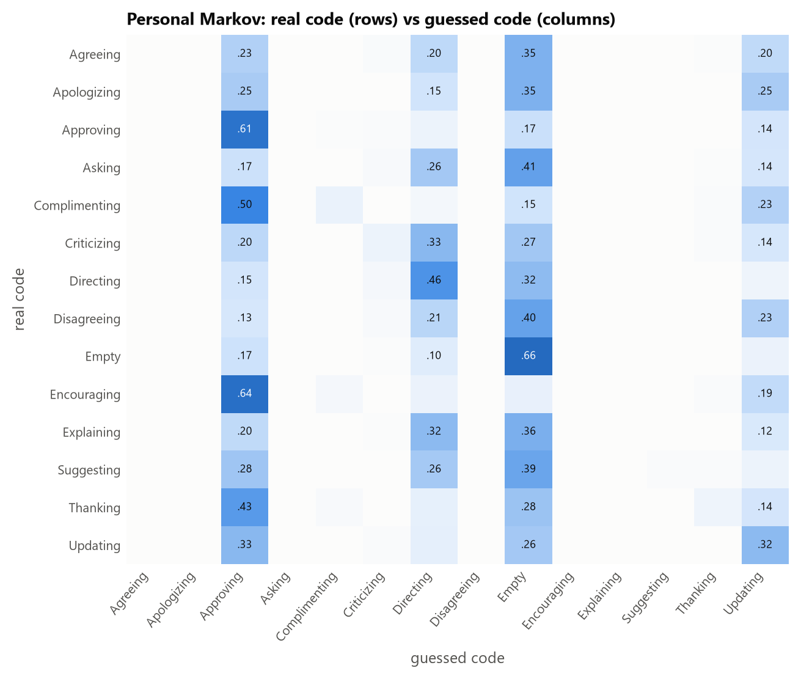

*Figure 5. Personal Markov (normalized smoothing) confusion matrix for Task A. Each row is a real code and adds to 1, so the diagonal is the recall for each code.*

**What Figure 5 shows.** The diagonal is strongest for Empty (0.66), Approving (0.61) and Directing (0.46). Each rare code is mostly predicted as a common code it tends to appear with:

- Positive codes go to Approving: Encouraging 0.64, Complimenting 0.50 and Thanking 0.43.
- Criticizing goes mostly to Directing (0.33).
- Asking, Explaining, Agreeing, Disagreeing, Apologizing and Suggesting go mostly to Empty (0.41, 0.36, 0.35, 0.40, 0.35 and 0.39).
- Updating is predicted as Approving (0.33) slightly more often than as Updating (0.32), because the two alternate (Section 4).

## 6. Results: the yes/no tasks from Deliverable 1 (Task B)

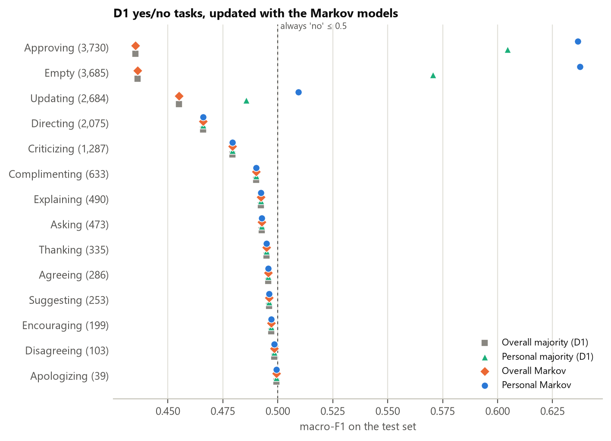

*Figure 6. Macro-F1 on each of the 14 yes/no tasks for all four models (Markov models with normalized smoothing). Codes are ordered from most to least common, with the number of utterances in brackets. The dashed line is 0.5, the most a model that always says "no" can score. Exact values, with accuracy, are in Appendix Table A1.*

**What Figure 6 shows.**

- **Three codes improve.** The personal Markov model has the highest macro-F1 for Approving (0.604 → 0.636 over the personal majority), Empty (0.571 → 0.638) and Updating (0.486 → 0.509).
- **Directing does not improve** (0.466, the same as always saying "no"). The highest chance the model gives Directing for any test utterance is 0.49, just under the 50% rule.
- **The overall Markov model** with smoothing never gives any code more than 50% (Section 4), so it matches the overall majority exactly on all 14 codes.
- **For the other 10 codes**, the four markers sit on top of each other: every model says "no" to every utterance.
  - Their score is $q/(1+q)$ (Section 3.5), which is why the rarest codes appear closest to 0.5.
  - Being closer to the line here means "rarer", not "better predicted".

*Table 9. Task B, per class, for the two personal models (personal Markov with normalized smoothing). Each cell is precision / recall / F1. "–" means the model never says "yes", so precision is undefined.*

| Code | Personal majority: no | Personal majority: yes | Personal Markov: no | Personal Markov: yes |
|---|---|---|---|---|
| Approving | 0.81 / 0.96 / 0.88 | 0.64 / 0.22 / 0.33 | 0.82 / 0.95 / 0.88 | **0.63 / 0.29 / 0.39** |
| Empty | 0.80 / 0.99 / 0.88 | 0.77 / 0.15 / 0.26 | 0.82 / 0.98 / 0.89 | **0.78 / 0.26 / 0.38** |
| Updating | 0.84 / 1.00 / 0.91 | 0.57 / 0.03 / 0.06 | 0.84 / 0.99 / 0.91 | **0.52 / 0.06 / 0.11** |
| Directing | 0.87 / 1.00 / 0.93 | – / 0.00 / 0.00 | 0.87 / 1.00 / 0.93 | – / 0.00 / 0.00 |
| Criticizing | 0.92 / 1.00 / 0.96 | – / 0.00 / 0.00 | 0.92 / 1.00 / 0.96 | – / 0.00 / 0.00 |
| Complimenting | 0.96 / 1.00 / 0.98 | – / 0.00 / 0.00 | 0.96 / 1.00 / 0.98 | – / 0.00 / 0.00 |
| Explaining | 0.97 / 1.00 / 0.98 | – / 0.00 / 0.00 | 0.97 / 1.00 / 0.98 | – / 0.00 / 0.00 |
| Asking | 0.97 / 1.00 / 0.99 | – / 0.00 / 0.00 | 0.97 / 1.00 / 0.99 | – / 0.00 / 0.00 |
| Thanking | 0.98 / 1.00 / 0.99 | – / 0.00 / 0.00 | 0.98 / 1.00 / 0.99 | – / 0.00 / 0.00 |
| Agreeing | 0.98 / 1.00 / 0.99 | – / 0.00 / 0.00 | 0.98 / 1.00 / 0.99 | – / 0.00 / 0.00 |
| Suggesting | 0.98 / 1.00 / 0.99 | – / 0.00 / 0.00 | 0.98 / 1.00 / 0.99 | – / 0.00 / 0.00 |
| Encouraging | 0.99 / 1.00 / 0.99 | – / 0.00 / 0.00 | 0.99 / 1.00 / 0.99 | – / 0.00 / 0.00 |
| Disagreeing | 0.99 / 1.00 / 1.00 | – / 0.00 / 0.00 | 0.99 / 1.00 / 1.00 | – / 0.00 / 0.00 |
| Apologizing | 1.00 / 1.00 / 1.00 | – / 0.00 / 0.00 | 1.00 / 1.00 / 1.00 | – / 0.00 / 0.00 |

The two overall models always say "no". Their "no" class has precision $q$, recall 1.00 and F1 $2q/(1+q)$, and their "yes" class is "– / 0.00 / 0.00" for every code.

**What Table 9 shows.**

- **The "no" class scores high everywhere.** It is the large class, and saying "no" is almost always right. The models differ only in the "yes" class.
- **Approving and Empty.** The personal Markov model finds more real "yes" utterances (recall 0.29 and 0.26, against 0.22 and 0.15) at about the same precision (0.63 and 0.78, against 0.64 and 0.77).
- **Updating.** It says "yes" for 159 utterances against 75 and finds 82 against 43 (recall 0.06 against 0.03), at slightly lower precision (0.52 against 0.57).
- **Directing.** Neither model ever says "yes".
- **Both models are cautious.** When they say "yes" they are usually right, but they find at most 29% of the real cases.

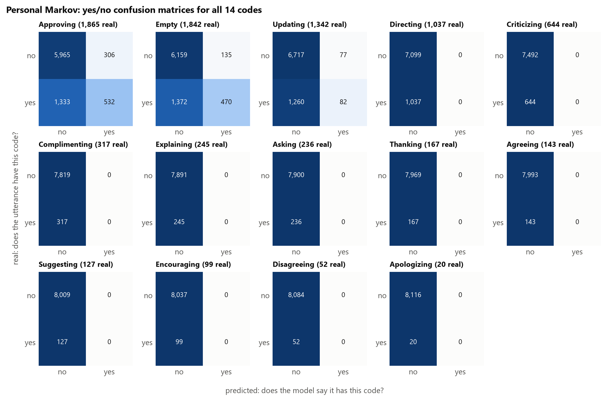

*Figure 7. Personal Markov (normalized smoothing) confusion matrices for all 14 yes/no tasks. In each panel, rows are the real answer and columns are the model's answer. Numbers are counts of test utterances. Shading is the share of the row, so the shade of the bottom-right cell is the recall for "yes". The same figure for the personal majority is Appendix Figure A3.*

**What Figure 7 shows.**

- **Most codes.** For 11 of the 14 codes, the right-hand column is all zeros: the model never says "yes", so every real case falls in the bottom-left cell (missed).
- **Approving, Empty and Updating.** The bottom-left cell is still much larger than the bottom-right. The model finds 532 of 1,865 real Approving utterances, 470 of 1,842 Empty ones and 82 of 1,342 Updating ones.

**Why most codes always get "no" with smoothing.** The model does carry information about the rare codes. On average, it gives the real code a higher chance than overall frequency does: Complimenting 0.107 against 0.039, Explaining 0.067 against 0.030, and Criticizing 0.124 against 0.079. But the 50% rule needs more than that.

- The highest chance the model ever gives Directing is 0.49, Complimenting 0.41 and Criticizing 0.31, so the answer is always "no".
- Only Empty, Approving and Updating ever go above 0.5.
- The cross-entropy and accuracy results in Section 5 capture this information, but the yes/no rule cannot show it.

### Smoothing in the yes/no tasks

*Table 10. Task B for the personal Markov model, with normalized smoothing and with no smoothing. "Says yes" counts the test utterances where the model answered "yes". "–" means the model never says "yes".*

| Code | Macro-F1: normalized | Macro-F1: none | Says yes: normalized / none | "Yes" precision / recall: normalized | "Yes" precision / recall: none |
|---|---|---|---|---|---|
| Approving | 0.636 | **0.661** | 838 / 1,096 | 0.63 / 0.29 | 0.60 / 0.35 |
| Empty | 0.638 | **0.648** | 605 / 845 | 0.78 / 0.26 | 0.65 / 0.30 |
| Updating | 0.509 | **0.547** | 159 / 377 | 0.52 / 0.06 | 0.43 / 0.12 |
| Directing | 0.466 | **0.552** | 0 / 235 | – / 0.00 | 0.47 / 0.11 |
| Criticizing | 0.479 | **0.491** | 0 / 26 | – / 0.00 | 0.31 / 0.01 |
| Complimenting | 0.490 | **0.551** | 0 / 71 | – / 0.00 | 0.34 / 0.08 |
| Explaining | 0.492 | **0.500** | 0 / 12 | – / 0.00 | 0.17 / 0.01 |
| Asking | 0.493 | **0.505** | 0 / 12 | – / 0.00 | 0.25 / 0.01 |
| Thanking | 0.495 | **0.500** | 0 / 13 | – / 0.00 | 0.08 / 0.01 |
| Agreeing | 0.496 | **0.514** | 0 / 19 | – / 0.00 | 0.16 / 0.02 |
| Suggesting | 0.496 | **0.525** | 0 / 9 | – / 0.00 | 0.44 / 0.03 |
| Encouraging | 0.497 | **0.515** | 0 / 11 | – / 0.00 | 0.18 / 0.02 |
| Disagreeing | 0.498 | 0.498 | 0 / 0 | – / 0.00 | – / 0.00 |
| Apologizing | 0.499 | 0.499 | 0 / 0 | – / 0.00 | – / 0.00 |

**What Table 10 shows.**

- **No smoothing is never worse.** It scores higher macro-F1 on 12 codes and ties on Disagreeing and Apologizing.
- **It says "yes" far more often.** For example, it says yes 1,096 times for Approving against 838, 377 times for Updating against 159, and 235 times for Directing against 0. It also says "yes" a few times for 8 of the 10 rarer codes.
- **Recall rises and precision falls.** For Approving, recall is 0.35 against 0.29, and precision is 0.60 against 0.63. Recall for "yes" was the weak side, so macro-F1 rises.
- **Accuracy is equal or slightly lower** on every code (Approving 0.798 against 0.799; Appendix Table A1), because the extra "yes" answers include more false positives.
- **The cause is the 50% rule.** A raw row built from a few transitions often puts more than half its weight on one code. 4.4% of test utterances get a raw row with probability 1 on a single code, against 0.5% with smoothing.
- **Rare codes gain little.** Their extra "yes" answers are mostly wrong (for Thanking, 1 right out of 13), so their macro-F1 barely moves.
- **The overall Markov model without smoothing** differs from its smoothed version on one code only. It says "yes" to Empty 13 times after Apologizing (5 right), so its macro-F1 for Empty is 0.439 against 0.436.

The yes/no confusion matrices for the personal Markov model without smoothing are in Appendix Figure A4.

## 7. Clustering the personal models

**Who is clustered.** I clustered the 56 of 106 commenters with at least 30 within-PR transitions. Below that, a personal model is mostly the commenter's own code frequencies (Section 3.4) and says little about the order of their codes. The clustering describes the commenters, so it uses all the data, not only the training set.

**Representation.** Each commenter is represented by their personal transition matrix with normalized smoothing ($\alpha = 30$, chosen by cross-validation on all the data). The matrix has 15 rows (START plus 14 codes) and 14 columns, and it is flattened into 210 probabilities, $x_i$.

**Method.**

- **k-means** splits the commenters into $k$ groups. It chooses each group's centre $\mu_j$ (the average of its members) to minimise $\sum_i \lVert x_i - \mu_{z_i} \rVert^2$, where $z_i$ is commenter $i$'s group. I used 50 random restarts and tried $k$ = 2 to 8.
- **Silhouette** measures how well separated the groups are.
  - For commenter $i$, $a(i)$ is the mean distance to the other members of its own group, and $b(i)$ is the mean distance to the members of the nearest other group.
  - Then $s(i) = \dfrac{b(i) - a(i)}{\max(a(i),\, b(i))}$, which runs from −1 to 1.
  - The silhouette score is the mean of $s(i)$. Near 1 means tight, well-separated groups; near 0 means commenters sit between groups.
  - I chose $k = 2$, which has the highest silhouette (0.321), though $k = 3$ (0.319) and $k = 4$ (0.320) are almost tied (Appendix Figure A2).
- **Adjusted Rand index (ARI)** measures how much two groupings of the same commenters agree.
  - The Rand index (RI) is the share of commenter pairs that both groupings treat the same way: either both put the pair together, or both keep it apart.
  - $\text{ARI} = \dfrac{\text{RI} - \mathbb{E}[\text{RI}]}{\max \text{RI} - \mathbb{E}[\text{RI}]}$, where $\mathbb{E}[\text{RI}]$ is the agreement expected by chance. An ARI of 1 means identical groupings and 0 means chance-level agreement.
- **Check.** Ward hierarchical clustering repeatedly merges the two groups whose merge adds the least within-group variance. It finds nearly the same groups as k-means (ARI 0.93).
- **PCA** (principal component analysis) is used only for Figure 8. It projects the 210 numbers onto the two directions along which commenters vary most. The clustering itself uses all 210 numbers.

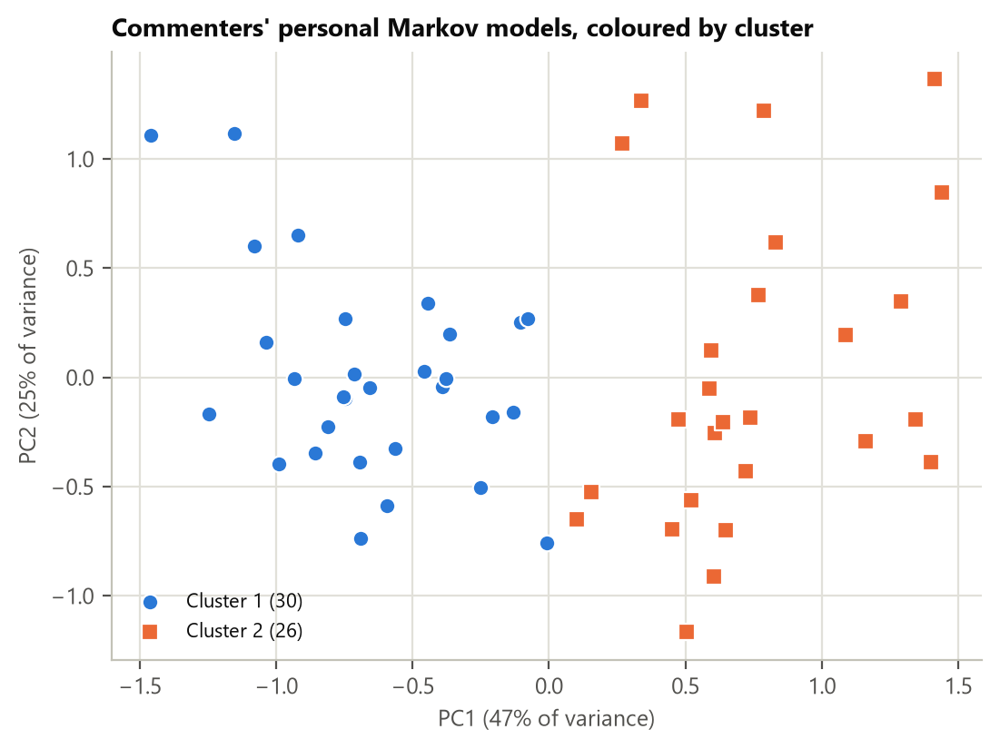

*Figure 8. Each clustered commenter's personal model, reduced to two dimensions with PCA and coloured by cluster.*

**What Figure 8 shows.** The first component (47% of the variance) separates cluster 1 (left) from cluster 2 (right), with the two groups meeting near 0 rather than leaving a clear gap. Together, the two components cover 72% of the variance. That is high for 210 numbers, and it fits the finding below: most of what varies between these matrices is a few dimensions of code mix.

*Table 11. The two clusters. "Above" and "below population" are the transitions where the cluster's average matrix differs most from the population matrix, looking only at the rows for START and the four common codes. Rows for rarely used previous codes differ even more (by up to ±0.29), but those rows mostly copy each commenter's own code mix (Section 3.4).*

| Cluster | Commenters | Teams | Most common codes | Above population | Below population |
|---|---|---|---|---|---|
| 1. Approval-oriented | 30 | 11 | Approving 38%, Updating 23%, Complimenting 9% | Directing → Approving +0.27, Empty → Approving +0.26, Updating → Approving +0.14 | Directing → Directing −0.28, START → Empty −0.21, Empty → Empty −0.21 |
| 2. Empty / Directing | 26 | 8 | Empty 29%, Directing 18%, Approving 13% | Approving → Empty +0.16, Updating → Empty +0.12, START → Empty +0.09 | START → Approving −0.16, Directing → Directing −0.14, Approving → Updating −0.09 |

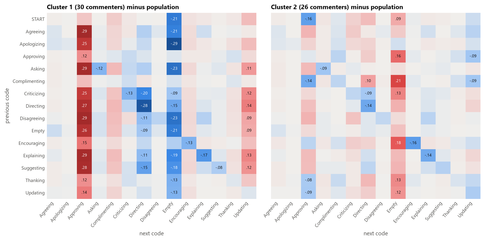

*Figure 9. Each cluster's average matrix minus the population matrix. Red means the transition happens more often than in the population, blue means less often.*

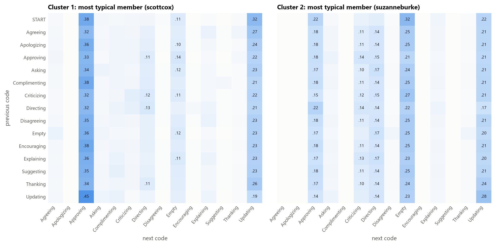

*Figure 10. The personal model of the commenter closest to each cluster's centre.*

**What Table 11 and Figures 9 and 10 show.**

- **The differences run down whole columns.** In Figure 9, cluster 1 is more likely than the population to produce Approving after most codes (by up to +0.29) and less likely to produce Empty. Cluster 2 is the reverse.
  - A shift down a whole column is what a difference in code mix looks like. A difference in order would show up in individual cells.
- **The few cell-level differences.** Cluster 1 rarely repeats Directing (Directing → Directing −0.28) or follows criticism with an instruction (Criticizing → Directing −0.20). Cluster 2 follows approval with Empty (Approving → Empty +0.16).
- **Typical members (Figure 10).**
  - Cluster 1's typical member opens a PR with Approving (0.38) or Updating (0.32), and returns to Approving after Updating (0.45).
  - Cluster 2's typical member opens with Empty (0.32). After Approving, they write Empty or Updating (0.21 each) about as often as another Approving (0.18).
  - In both, the rows for rarely used previous codes (such as Agreeing) look like that person's overall code mix, because that is what smoothing fills them with.
- **Team 14.** All four team-14 commenters, who produce long runs of Empty utterances, are in cluster 2.

**Caveats.**

- **The clusters are mostly code mix.** Clustering the same commenters on their code frequencies alone gives almost the same groups (ARI 0.93).
  - This is partly built in. Smoothing toward each commenter's own code frequencies makes every sparse row a copy of their code mix, so each matrix repeats the code mix many times.
  - The relatively high silhouette (0.32) reflects that repetition more than any difference in order.
- **The number of clusters is not clear-cut.** $k$ = 2, 3 and 4 have almost the same silhouette.
- **Without smoothing, the structure disappears.** Clustering the raw matrices gives a silhouette of 0.08 or less for every $k$, and at $k = 2$ its groups agree only partly with the smoothed ones (ARI 0.61). Raw rows built from one or two transitions are often ε, 0.5 or 1, and that noise swamps the real differences between commenters.

## 8. Limitations and next steps

- **The models are first-order.** They only look one code back, and START treats every PR opening the same.
- **The order within a comment follows the file.** 49% of within-PR transitions fall inside one comment, and the file order may not reflect the order in which the reviewer wrote things.
- **PR authors are included.** 11% of utterances are written by the PR's own author, and these are modelled the same way as reviewers' utterances.
- **ε sets part of the cross-entropy.** Under the personal-only rule, a commenter's first use of a code costs $\log_2(1/\varepsilon)$ bits. So cross-entropy comparisons between the personal and population models depend on ε (Section 5). Accuracy and F1 do not.
- **Some settings are choices:** the 30-transition threshold for clustering and the 50% rule for yes/no predictions. Neither has been checked for sensitivity yet. Section 6 shows that the 50% rule hides most of what the models know about rare codes.
- **The smoothing strength was chosen for cross-entropy.** It is not the best strength for yes/no macro-F1, where no smoothing does better (Section 6). A smaller strength, or a threshold other than 50%, may beat both options on that metric.
- **Next steps:**
  - Cluster on what is left after removing each commenter's code mix, for example each row minus their own code frequencies. This would show whether the order of codes separates commenters at all.
  - Check whether the clusters survive once team is controlled for.
  - Move to hidden-state models (Deliverable 5).

## Reproducing

From the project root:

```
.venv/Scripts/python.exe src/data_overview.py     # Tables 1-2, Figure 1
.venv/Scripts/python.exe src/visualize_markov.py  # Figures 2-3
.venv/Scripts/python.exe src/run_markov.py        # Tables 7-10, A1 (both smoothing options); Figures 4-7, A1, A3, A4; outputs/*.csv
.venv/Scripts/python.exe src/cluster_markov.py    # Table 11, the no-smoothing clustering check; Figures 8-10, A2
.venv/Scripts/python.exe src/evaluation.py        # Deliverable 1 baselines and their confusion matrices
.venv/Scripts/python.exe -m pytest                # tests
```

## Appendix

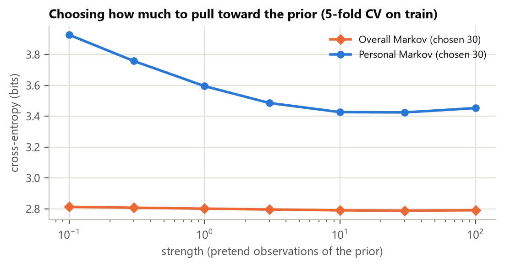

*Figure A1. Cross-entropy for each smoothing strength in 5-fold cross-validation on the training set.*

**What Figure A1 shows.**

- **Personal Markov depends most on the strength.** With almost no smoothing (0.1) it scores 3.93 bits. It improves up to 10–30 (3.43 bits at both) and gets slightly worse at 100 (3.45), where every row becomes the commenter's code mix.
- **These values are higher than on the test set (3.12)**, most likely because each cross-validation model is fit on 80% of the training data. Commenters then have fewer utterances, so more test codes are ones they "never used" and get ε.
- **Overall Markov barely changes** (2.79 to 2.81 bits), because the pooled population matrix has enough data in almost every row.
- **Strength 0 (no smoothing) cannot be drawn on the log scale.** On the test set it scores 6.21 bits (Section 5).

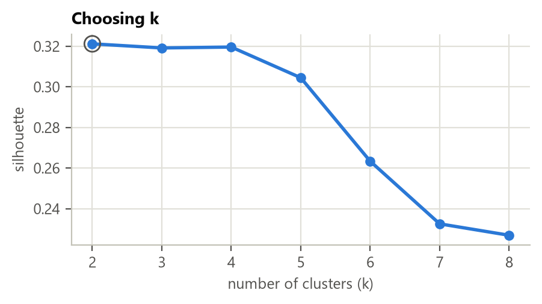

*Figure A2. Silhouette score for each number of clusters.*

**What Figure A2 shows.** The silhouette is nearly flat from $k = 2$ to $k = 4$ (0.321, 0.319, 0.320) and falls after that. Two clusters is the simplest choice among three almost equal ones.

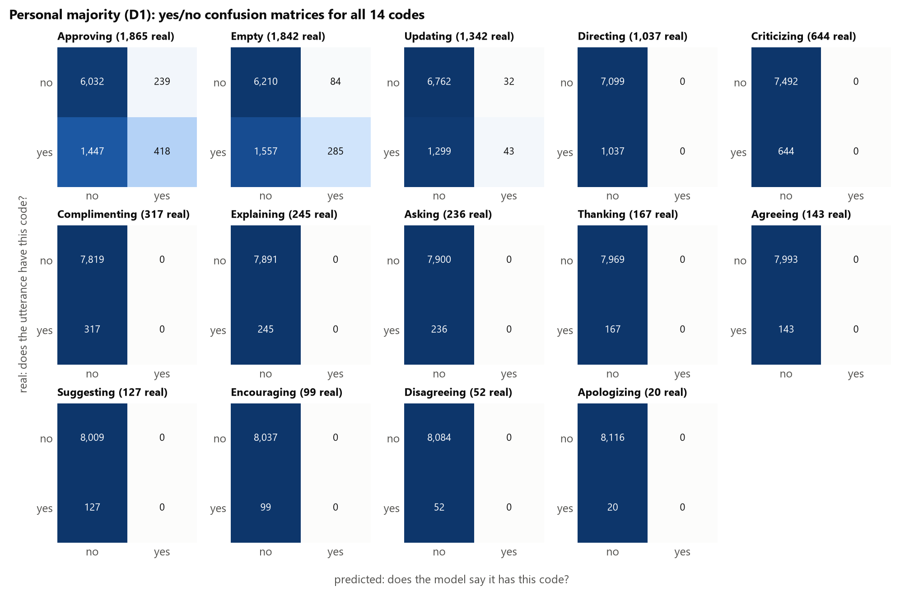

*Figure A3. Personal majority (Deliverable 1) confusion matrices for all 14 yes/no tasks, in the same layout as Figure 7.*

**What Figure A3 shows.** The personal majority says "yes" for only three codes: Approving (418 of 1,865 found), Empty (285 of 1,842) and Updating (43 of 1,342). For the other 11 codes it never says "yes". Compared with Figure 7, the personal Markov model finds more of all three: 532, 470 and 82.

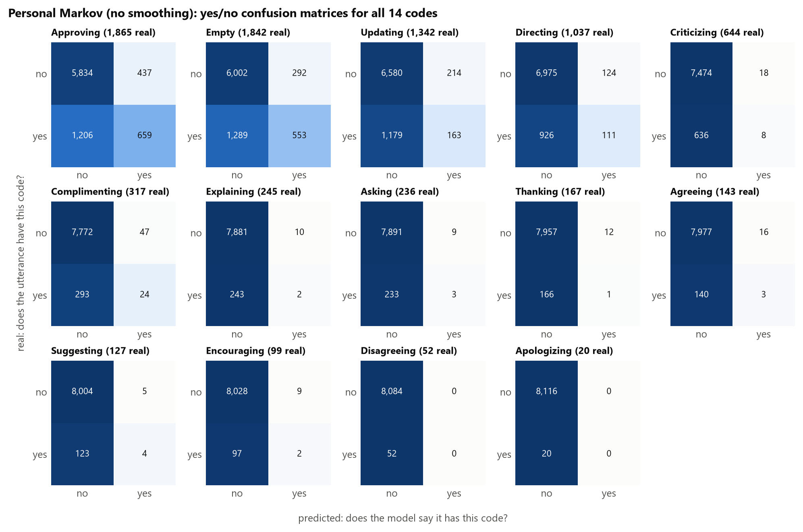

*Figure A4. Personal Markov confusion matrices for all 14 yes/no tasks with no smoothing, in the same layout as Figure 7.*

**What Figure A4 shows.**

- **The right-hand column fills in.** Compared with Figure 7, the model says "yes" for 12 of the 14 codes instead of 3.
- **Common codes.** It finds more real cases (Approving 659 against 532, Updating 163 against 82, Directing 111 against 0), at the cost of more wrong "yes" answers (437 against 306 for Approving).
- **Rare codes.** It says "yes" only a handful of times, and mostly wrongly.

*Table A1. Task B accuracy and macro-F1 for every code and model. Markov models use normalized smoothing unless marked. The overall majority and overall Markov columns are identical, because both always say "no". Without smoothing, overall Markov differs only on Empty (0.773 / 0.439).*

| Code | Overall majority acc. / macro-F1 | Personal majority acc. / macro-F1 | Overall Markov acc. / macro-F1 | Personal Markov acc. / macro-F1 | Personal Markov, no smoothing acc. / macro-F1 |
|---|---|---|---|---|---|
| Approving | 0.771 / 0.435 | 0.793 / 0.604 | 0.771 / 0.435 | 0.799 / 0.636 | 0.798 / 0.661 |
| Empty | 0.774 / 0.436 | 0.798 / 0.571 | 0.774 / 0.436 | 0.815 / 0.638 | 0.806 / 0.648 |
| Updating | 0.835 / 0.455 | 0.836 / 0.486 | 0.835 / 0.455 | 0.836 / 0.509 | 0.829 / 0.547 |
| Directing | 0.873 / 0.466 | 0.873 / 0.466 | 0.873 / 0.466 | 0.873 / 0.466 | 0.871 / 0.552 |
| Criticizing | 0.921 / 0.479 | 0.921 / 0.479 | 0.921 / 0.479 | 0.921 / 0.479 | 0.920 / 0.491 |
| Complimenting | 0.961 / 0.490 | 0.961 / 0.490 | 0.961 / 0.490 | 0.961 / 0.490 | 0.958 / 0.551 |
| Explaining | 0.970 / 0.492 | 0.970 / 0.492 | 0.970 / 0.492 | 0.970 / 0.492 | 0.969 / 0.500 |
| Asking | 0.971 / 0.493 | 0.971 / 0.493 | 0.971 / 0.493 | 0.971 / 0.493 | 0.970 / 0.505 |
| Thanking | 0.979 / 0.495 | 0.979 / 0.495 | 0.979 / 0.495 | 0.979 / 0.495 | 0.978 / 0.500 |
| Agreeing | 0.982 / 0.496 | 0.982 / 0.496 | 0.982 / 0.496 | 0.982 / 0.496 | 0.981 / 0.514 |
| Suggesting | 0.984 / 0.496 | 0.984 / 0.496 | 0.984 / 0.496 | 0.984 / 0.496 | 0.984 / 0.525 |
| Encouraging | 0.988 / 0.497 | 0.988 / 0.497 | 0.988 / 0.497 | 0.988 / 0.497 | 0.987 / 0.515 |
| Disagreeing | 0.994 / 0.498 | 0.994 / 0.498 | 0.994 / 0.498 | 0.994 / 0.498 | 0.994 / 0.498 |
| Apologizing | 0.998 / 0.499 | 0.998 / 0.499 | 0.998 / 0.499 | 0.998 / 0.499 | 0.998 / 0.499 |

**What Table A1 shows.**

- **Accuracy says little here.** For every code, accuracy is close to the share of "no" utterances, even for models that find nothing, so macro-F1 is the measure to compare (Section 3.5).
- **The two measures can disagree.** Without smoothing, the personal Markov model has higher macro-F1 than with smoothing, but equal or slightly lower accuracy on every code.
